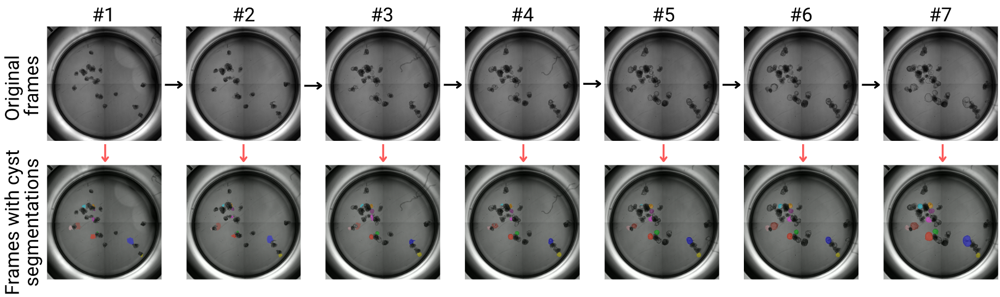

# Organoid Tracker

[](https://github.com/hrlblab/OrganoidTracker/actions/workflows/ci.yml)

Track and measure cysts in time-lapse videos of kidney organoids. You draw a box around each cyst on the
last frame; [SAM 2](https://github.com/facebookresearch/sam2) segments it and follows it backwards in
time, and the application reports each cyst's area, shape and growth. No training data is needed.

**Paper:** [Organoid Tracker: A SAM2-Powered Platform for Zero-shot Cyst Analysis in Human Kidney Organoid Videos](https://arxiv.org/abs/2509.11063)
(Huang, Maxson, Nguyen, Song and Huo, arXiv 2509.11063).
**Contact:** [xiaoyu.huang@vanderbilt.edu](mailto:xiaoyu.huang@vanderbilt.edu)


## Get started

**Docker on Linux, no Python needed.** Download the bundle and the image for your computer from the
[releases page](https://github.com/hrlblab/OrganoidTracker/releases), unpack them as the release notes
show, and run `./organoidtracker`. The application opens in your browser; videos and results stay on
your computer. The [Docker guide](packaging/docker/README.md) covers host preparation and recovery.

**From source, Linux or Windows.** You need Python 3.12 or 3.13 and [uv](https://docs.astral.sh/uv/).
An NVIDIA GPU is strongly recommended; the CPU path works but is slow.

```bash
git clone https://github.com/hrlblab/OrganoidTracker.git
cd OrganoidTracker
uv sync --extra qt                    # add --extra cpu on a computer without an NVIDIA GPU
bash checkpoints/download_ckpts.sh    # the public SAM 2.1 weights
uv run --no-sync organoidtracker-qt
```

Other install paths (pip, the Tk interface, CUDA wheels on Windows) are in
[docs/development.md](docs/development.md).

## Use it

1. **Open video.** MP4 time-lapse videos are supported.
2. **Confirm the time points.** Check which source frames are separate acquisitions and enter their
   days. Nothing is assumed; annotation stays locked until you confirm.
3. **Annotate the last frame.** Click an organoid, then drag a box around each of its cysts. Include
   organoids without cysts: they count in the population statistics.
4. **Track and save run.** Every run is saved in its own folder and can be reopened later without a model.
5. **Read the results.** Inspect the masks frame by frame, then open the report folder.



The same pipeline runs without a window (`organoidtracker run`, `export`, `validate`). The interfaces
and the command line are described in [docs/usage.md](docs/usage.md).

## What you get

Each run folder holds:

| File | Content |
|---|---|
| `organoid_analysis_report.pdf` | Summary, figures, and the source frames with their days |
| `raw_cyst_data.csv` | One row per cyst and time point: area, circularity, source frame |
| `cyst_summary.csv` | One row per cyst, with its growth rate |
| `organoid_summary.csv` | One row per organoid, with summed cyst areas |
| `videos/` | Overlay, mask and side-by-side videos |
| `visualizations/` | The individual figures |
| `results.json`, `masks-*.npz` | The saved masks and inputs, for reopening and exporting again |
| `run_manifest.json` | Software version, settings, and a hash of every file written |


Definitions of area, circularity and growth rate are in [docs/measurements.md](docs/measurements.md).

## Versions and the paper

The repository has changed since the paper. Cite the version you used; exports name it, together with a
*results version* that increases whenever a change alters numbers.

| Version | Pinned at | What it is |
|---|---|---|
| Paper submission | commit [`d748b21`](https://github.com/hrlblab/OrganoidTracker/tree/d748b21) (2025-09-15) | The code as submitted to arXiv. Tk interface. |
| Original code, final state | tag [`legacy-baseline`](https://github.com/hrlblab/OrganoidTracker/tree/legacy-baseline) (2026-01-31) | The paper code plus installation and plot-setting changes. Kept unchanged on branch `legacy`. |
| Corrected method | commit [`494e053`](https://github.com/hrlblab/OrganoidTracker/tree/494e053) (2026-10-13), results version 2 | The paper's method with the first corrections: tracking order and analysis bookkeeping. Tk interface and command line. |
| Current prerelease | tag [`v2.0.0a2`](https://github.com/hrlblab/OrganoidTracker/tree/v2.0.0a2) (2026-11-19), results version 5 | Further corrections, plus the Qt desktop and the Docker bundle, which are new and not part of the paper. |

Use the current prerelease for new analyses: it contains every correction. Numbers from the paper-era
code are not comparable with it. The largest change is that tracking now runs backwards from the last
frame as the paper describes; the original code tracked forwards from the first frame.
[CHANGELOG.md](CHANGELOG.md) lists every change under "Scientific behavior".

## Known limitations of this prerelease

- **Organoid totals count a missing mask as no area.** A cyst without a mask on the first or last day
  changes its organoid's growth rate in `organoid_summary.csv`. Compare growth with `cyst_summary.csv`.
- **Circularity rises with size.** An ideal disc measures 0.76 at a radius of 5 pixels and 0.90 at 120,
  so a cyst that only grows appears to become rounder. Compare cysts of similar size.
- **Bright-field videos only.** Accuracy against expert annotations has not been measured.
- **Docker preview.** Linux x86-64 only, on a trusted single-user host: its desktop has no login.

Details are in [docs/measurements.md](docs/measurements.md#known-limitations).

## Citation

```bibtex
@article{huang2025organoid,
  title={Organoid Tracker: A SAM2-Powered Platform for Zero-shot Cyst Analysis in Human Kidney Organoid Videos},
  author={Huang, Xiaoyu and Maxson, Lauren M and Nguyen, Trang and Song, Cheng Jack and Huo, Yuankai},
  journal={arXiv preprint arXiv:2509.11063},
  year={2025},
  doi={10.48550/arXiv.2509.11063}
}
```

The same metadata is in [CITATION.cff](CITATION.cff).

## License and acknowledgments

Apache-2.0; see [LICENSE](LICENSE). Third-party notices, including for the vendored SAM 2 code under
`src/sam2`, are in [NOTICE](NOTICE). This work builds on
[Segment Anything Model 2](https://github.com/facebookresearch/sam2) by Meta AI.
