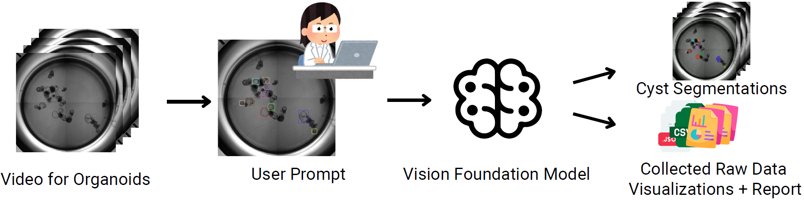
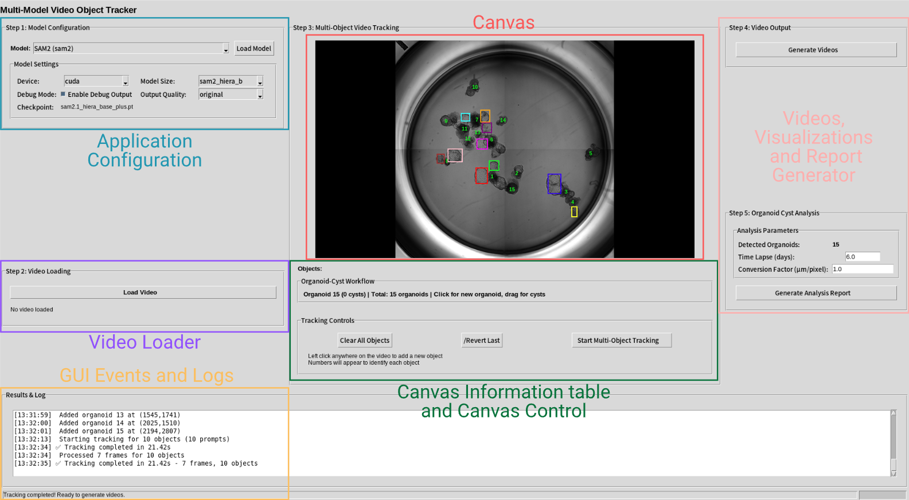
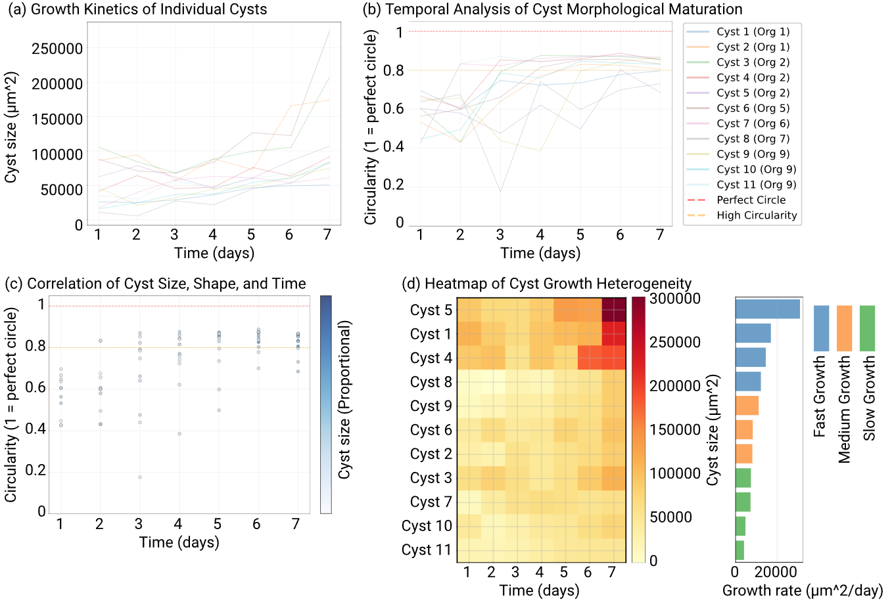

# Organoid Tracker: A SAM2-Powered Platform for Zero-shot Cyst Analysis in Human Kidney Organoid Videos

This is the official implementation of Organoid Tracker, a comprehensive AI-powered platform for automated kidney organoid cyst tracking and quantitative analysis.

**Paper**
> [**Organoid Tracker: A SAM2-Powered Platform for Zero-shot Cyst Analysis in Human Kidney Organoid Videos**](#)
> Xiaoyu Huang, Lauren M Maxson, Trang Nguyen, Cheng Jack Song, and Yuankai Huo
> *arXiv (2509.11063)*

Contact: [xiaoyu.huang@vanderbilt.edu](mailto:xiaoyu.huang@vanderbilt.edu). Feel free to reach out with any questions or discussion!

## Abstract



Quantitative analysis of kidney organoid cyst dynamics is crucial for understanding nephron development and disease mechanisms. Current approaches rely on manual annotation and specialized expertise, limiting scalability and reproducibility. We present Organoid Tracker, a user-friendly platform that leverages the Segment Anything Model 2 (SAM2) for zero-shot segmentation and automated tracking of cyst formation in time-lapse microscopy videos. Our platform introduces an innovative inverse temporal tracking workflow that improves accuracy by annotating the final, clearest frame and tracking backward in time. The system automatically extracts quantitative metrics including individual cyst growth kinetics, morphological maturation patterns, and population heterogeneity analysis, providing researchers with comprehensive analytical capabilities without requiring programming expertise.

## Linux Docker desktop preview

The [Docker desktop bundle](packaging/docker/README.md) runs the complete interactive application
in a local browser with remembered video, model-cache and results folders. It provides separate CPU
and NVIDIA images and requires no host Python or Qt installation. The preview currently targets
Linux x86-64; Windows Docker validation and a separate clean-host trial remain pending.

## Highlights

- **Zero-Shot Learning**: No training data required - works immediately with SAM2's foundation model capabilities
- **Inverse Temporal Tracking**: Novel backward-in-time approach that leverages mature cyst morphology for improved accuracy
- **Comprehensive Analytics**: Automated extraction of growth kinetics, morphological metrics, and population-level statistics
- **User-Friendly Interface**: Intuitive GUI designed specifically for biological researchers

## User Interface



The Organoid Tracker interface is organized into functional modules: (top-left) application configuration for model selection, (bottom-left) progress tracking log, (center) main canvas for video display and user interaction, and (right) analysis parameter input and report generation modules.

## Visual Results


Side-by-side comparison showing original time-lapse video frames (top row) with corresponding Organoid Tracker output (bottom row), where automatically generated segmentation masks with unique colors track individual cysts over time.

## Quantitative Metrics and Analysis Suite




**Key Measurements:**
- **(a) Cyst Area Tracking**: Cross-sectional area measurement across multiple time points
- **(b) Morphological Analysis**: Circularity comparison between irregular and well-defined cysts
- **(c) Population Metrics**: Comprehensive organoid and cyst identification at initial and final time points
- **(d) Population-level Growth Heterogeneity**: Individual cyst growth rate analysis and temporal relationship visualization

Representative analysis output for a PKD mutant organoid video showing: **(a)** Cyst area trajectories with progressive growth, **(b)** morphological maturation tracking circularity evolution, **(c)** correlation visualization of size, shape, and temporal relationships, **(d)** population-level growth heterogeneity heatmap with individual cyst growth rates.

## Installation

### Prerequisites
- Python 3.12 or 3.13 and [uv](https://docs.astral.sh/uv/) (pip also works, see below)
- Linux or Windows. An NVIDIA GPU is strongly recommended: the CPU path works but is slow
- Tk for the desktop interface (included with the python.org and uv-managed interpreters; on Debian/Ubuntu install `python3-tk`)
- 8 GB+ RAM; 2 GB+ of GPU memory for the base-plus model on 4096 x 4096 videos

### Install with uv (recommended)

```bash
git clone https://github.com/hrlblab/OrganoidTracker.git
cd OrganoidTracker
uv sync --extra tk            # Linux: PyPI torch with CUDA 13; Windows: CPU torch
```

Pick the PyTorch build explicitly when needed:

```bash
uv sync --extra tk --extra cuda   # NVIDIA GPU on Windows or Linux (CUDA 13.0 wheels; driver 580 or newer)
uv sync --extra tk --extra cpu    # CPU only (smaller download)
```

`uv.lock` pins every dependency for Linux and Windows; `uv sync` creates `.venv` from it.

### Install with pip

```bash
python -m venv .venv
source .venv/bin/activate        # Windows: .venv\Scripts\activate
pip install -r requirements.txt  # exported from uv.lock
pip install -e .
# NVIDIA GPU on Windows: pip install torch torchvision --index-url https://download.pytorch.org/whl/cu130
```

### Verify the installation

```bash
uv run python -c "import torch, organoidtracker; print(torch.__version__, 'CUDA:', torch.cuda.is_available())"
```

### Model checkpoints

```bash
cd checkpoints
bash download_ckpts.sh        # SAM 2.1 (default); `bash download_ckpts.sh 2` for the original SAM 2 files
cd ..
```

The application looks for checkpoints in `./checkpoints` (or `ORGANOIDTRACKER_CHECKPOINTS`).

### Settings

Defaults live in the package (`organoidtracker.settings.Settings`). To change any of them, copy
[`organoidtracker.example.toml`](organoidtracker.example.toml) to `organoidtracker.toml` in the directory you
launch from (or point `ORGANOIDTRACKER_SETTINGS` at a file) and uncomment the keys you need; keys and value
types are checked at startup. A legacy `user_config.py` is still read for now, with a deprecation warning.

## Quick Start

### Basic Usage

1. **Launch the Application**
   ```bash
   uv run organoidtracker-tk
   ```
   (`python video_tracker_gui.py` inside the environment does the same.) Outputs, the prompt
   records and the log file (`data/output_videos/organoidtracker.log`) are written under `data/`
   in the directory you launch from.

2. **Load Your Video**
   - Click "Load Video" and select your time-lapse organoid video
   - Supported formats: MP4

3. **Configure Tracking**
   - Select the SAM2 model size (small, base-plus or large)
   - Keep "Reverse Tracking" enabled (recommended for organoid analysis)
   - Adjust tracking thresholds and other settings in `organoidtracker.toml` if needed (see Settings above)

4. **Annotate Cysts**
   - With Reverse Tracking enabled the canvas shows the final frame of the video, where cysts are clearest
   - Left-click an organoid, then click and drag bounding boxes around its cysts; left-click again to start the next organoid
   - Each cyst is assigned a unique color
   - Confirm source frames and acquisition days before annotating. Similar-looking images are never automatically discarded.

5. **Run Analysis**
   - Click "Start Tracking" to begin automated segmentation
   - Monitor progress in the log panel
   - Processing time varies with video length and model size

6. **Review Results**
   - Generated outputs saved to `data/output_videos/`
   - Includes tracking videos, analysis reports, and raw data
   - Every tracking run that kept masks is saved automatically, right after tracking, in a directory of
     its own: `data/output_videos/runs/<video>_<timestamp>_<run id>/` with `results.json`, the mask file,
     `session.json` and `prompts.json`. It reopens with "Open Results..." and exports again with
     `organoidtracker export --run <directory> --out <new directory>`, even if it was never exported or saved by hand.
     Generating the analysis report updates it with the time lapse, conversion factor and organoids the report
     used, so that exporting it again reproduces the report; "Save Results..." writes a copy into a directory of
     your choice.


### Qt desktop application (preview)

```bash
uv sync --extra qt                  # add --extra hf for the optional Transformers backend
uv run --no-sync organoidtracker-qt
```

Open a video or a saved session. Confirm the acquisition selection before annotating; until then a
click on the picture explains what is missing. The canvas then shows the last selected frame for
reverse tracking. Click an organoid, drag boxes around its cysts, then click the next organoid.
Include organoids without cysts because they contribute to the population statistics. Select an
existing organoid in the annotation list to add more cysts to it. Use the wheel to zoom, right or
middle drag to pan, and Fit to restore the view. Undo/Redo and removal operate on source-pixel
coordinates at every zoom level.

Choose the model family, size, device and weights, then check the pixel calibration and time span.
The acquisition panel lets you inspect source frames with the slider and select their one-based
numbers. **7 daily points (11-frame export)** fills source frames `1, 3, 4, 6, 7, 9, 10` and days
`1–7` for that confirmed export layout only. Check the mapping and click **Confirm frames and days**.
For other videos, select every source frame or enter your own list and dates. A newly opened video has
no default span: enter the days from the first to the last frame, or one day per frame, and check the
table of source frames and days before confirming. Clear annotations before changing frames so that
existing boxes cannot move to another observation; for the same reason the tracking direction is locked
while annotations exist and is not remembered between sessions. Days of the same frames can be corrected
with annotations in place, and the changed days must be confirmed again before tracking. The selected
source indices and actual days are saved with each session and run. Reopening old results preserves their
recorded map; old sessions without a map need confirmation before new tracking.

**Track and save run** writes
each run into its own directory under `data/output_videos/runs/` (change its parent with **Run folder**).
Masks are saved before reports, so a report failure can be recovered with **Open results**. Cancel
finishes the current frame and preserves retained masks; closing during a task waits for that task
and its save to finish. Partial and cancelled runs retain their status.

Use the frame slider to inspect originals, overlays, masks and side-by-side views. Each mask carries
its cyst label (`C1`, `C2`, …) in the colour shown in the annotation list; selecting a cyst there
outlines its mask. The Figures tab
shows the generated plots; **Open report folder** provides the PDF, CSV tables and videos. Saved
annotations stay read-only until **Edit prompts for a new run**. **Export reports to a new copy**
re-analyzes retained masks with the selected calibration/timestamps, and preserves those inputs in
every copied session and result document. The original run remains intact. Missing source videos
do not prevent mask inspection or report export without videos; **Locate source video** accepts a
relocated file only when its content hash matches.

The Qt interface is a preview while interactive Linux acceptance and native Windows CPU/GPU checks
are pending. The Tk application remains available. Run Qt regression tests offscreen with
`uv sync --extra qt --group qt-test`, then `QT_QPA_PLATFORM=offscreen uv run --no-sync pytest -m qt`
(on Windows, set that environment variable using the shell's syntax).

An experimental CPU directory bundle can also be built using the [packaging recipe](packaging/README.md).
Checkpoints remain external to the bundle; native Windows distribution validation is pending.

### Headless runs (command line)

The same tracking, analysis and exports run without a window from a *session file*: a JSON document
with the video, the organoid points and cyst boxes (source pixels on the annotation frame, the last
frame with reverse tracking), the calibration and the timing. The prompt record the application writes
when tracking starts (`data/output_videos/prompts/*.json`) is accepted as a session file, so a GUI run can
be repeated headlessly.

```json
{
  "schema": "organoidtracker.session/1",
  "video": {"path": "well.mp4", "decoded_frames": 11, "frame_indices": [0, 2, 3, 5, 6, 8, 9]},
  "tracking": {"direction": "reverse", "model_config": "sam2_hiera_b", "device": "cuda"},
  "calibration": {"um_per_pixel": 1.6934},
  "timing": {"time_lapse_days": 6.0},
  "organoids": [
    {"organoid_id": 1, "point": [1300, 700],
     "cysts": [{"cyst_id": 1, "bbox": [1200, 800, 1400, 1000]}, {"cyst_id": 2, "bbox": [1500, 820, 1650, 960]}]},
    {"organoid_id": 2, "point": [600, 2400], "cysts": []}
  ]
}
```

```bash
uv run organoidtracker validate --session session.json
uv run organoidtracker run --session session.json --out runs/well-01 [--video other/path.mp4] [--device cpu] [--model sam2_hiera_t] [--no-videos] [--video-quality original|mid|low]
uv run organoidtracker export --run runs/well-01 [--out runs/well-01-replot] [--video other/path.mp4] [--no-videos] [--video-quality original|mid|low] [--overwrite]
```

A session's `video.frame_indices` is a strictly increasing list of **zero-based** source indices;
`video.decoded_frames` records the expected decoded count. A mismatch fails before tracking.
For an older session, CLI `run`/`bench` accept `--frames 1,3,4,6,7,9,10 --decoded-frames 11`
(one-based CLI numbers). Confirm that the session's timing describes those selected observations.
`timing` takes either `time_lapse_days` (spread uniformly from day 1 as in the paper) or
`frame_times_days`, one explicit time per selected time point. Every key of `tracking` is optional; `--video`
relocates a moved video (its recorded `sha256`, when present, must still match). The output directory
receives the CSV tables, figures and PDF report (re-plottable with `scripts/csv_visualizer.py`), the
videos under `videos/`, the prompt record (`prompts.json`), the validated session (`session.json`), the log,
the saved tracking result (`results.json` and `masks-<digest>.npz`: every mask as packed bits, with the
organoid and cyst identities, the time axis, the calibration, the frame map, the tracking status and
coverage, the presence scores, the settings and the provenance; written right after tracking, before any
export), and `run_manifest.json`: software, environment and settings, the video facts, the backend
provenance, the tracking status and frame coverage, a digest of every mask, and the hash of every file written.

`organoidtracker export` reopens a run directory **without a model** and writes its analysis again: the
CSV tables, figures, PDF, summary and manifest, plus the videos when the video file is available (`--video`
relocates a moved file with the same content; `--no-videos` needs no video at all). In place (`--run` alone)
it needs `--overwrite` and keeps the saved result, session, prompt record and log; with `--out` another
directory receives a copy of the saved result as well, so it is a complete run directory too. The exports
equal the original run's for the same software and settings. A damaged, truncated or edited result file is
refused. Tracking again from the saved prompts is `run --session runs/well-01/session.json`; continuing an
interrupted propagation exactly is not supported (SAM 2 keeps an inference memory beyond the saved masks).

Exit status: 0 completed; 1 failed; 2 invalid input (session, settings, saved result, missing or different
video); 3 the tracking stopped early and the exports are **partial** (the manifest, the summary and the PDF
say so; `export` reports the status of the run it exports again); 4 the run was **cancelled**: the first Ctrl-C
asks the tracking to stop after the frame in progress (SAM 2's per-frame inference is not interruptible), the
tracked frames are saved, analyzed and exported with the status `cancelled`, and a second Ctrl-C aborts at once.
A run cancelled before any mask was kept writes only the session and the prompt record.

## Output Files

After analysis, the following files are generated in `data/output_videos/`:

- `multi_object_overlay.mp4` - Annotated tracking video
- `multi_object_mask.mp4` - Binary mask visualization
- `multi_object_side_by_side.mp4` - Original and mask comparison
- `organoid_summary.csv` - Quantitative metrics data
- `organoid_analysis_report.pdf` - Publication-ready report
- `analysis_summary.json` - Complete session metadata
- `visualizations/` - Individual plots and figures
- `prompts/<video>_<timestamp>_<run id>.json` - Prompts, organoid associations and provenance of each tracking run
- `runs/<video>_<timestamp>_<run id>/` - The saved result of each tracking run in the window (see Review Results)

### Frame order and timing

Frames are handled in chronological order throughout. With Reverse Tracking enabled, prompts are placed on the last frame and SAM2 propagates backwards in time; outputs are always written chronologically. The tracking progress dialog has a Cancel button: the frame in progress finishes, the tracked frames stay available for videos, the report and Save Results (as a cancelled run), and tracking again on the same video produces the masks of an uninterrupted run. The "Time Lapse (days)" value is the span from the first to the last frame, and days are numbered from 1 as in the paper's figures (seven daily frames spanning six days are days 1 to 7).

### Optional Transformers backend and benchmarks

The reference SAM 2 backend remains the default. Install `uv sync --extra hf` to opt into
`hf-sam2`, which loads a **local** Hugging Face SAM 2/2.1 snapshot. Model loading never downloads
weights. For a reproducible tiny-model example, download the public snapshot separately:

```bash
uv run --no-sync python -c "from huggingface_hub import snapshot_download; snapshot_download('facebook/sam2.1-hiera-tiny', revision='de431c4043854a71d8101e17995dfe596bf101a5', allow_patterns=['*.json', 'model.safetensors'], local_dir='checkpoints/hf/sam2.1-hiera-tiny')"
uv run --no-sync organoidtracker bench --session session.json --out reference --model sam2_hiera_t --no-videos
uv run --no-sync organoidtracker bench --session session.json --out candidate --model sam2_hiera_t --backend hf-sam2 --checkpoint checkpoints/hf/sam2.1-hiera-tiny --reference reference --no-videos
```

`tracking.backend` in a session can also select `hf-sam2`; `tracking.checkpoint_path` then names
the snapshot directory. Match the session's model size and checkpoint family to that snapshot.
The adapter uses the reference's PIL preprocessing, chronological frames, quality filters and packed
masks. The application-specific improved base-plus configuration is unsupported. This backend is
experimental; it still shares code with the vendored adapter and does not replace the vendored package.

Each benchmark produces a normal saved run plus `benchmark.json` and `benchmark.csv`. These record
tracking time, seconds per processed frame, process peak RAM (unavailable on Windows), CUDA allocated
peak memory, mask intersection-over-union (IoU), area differences and changes in reference identity
assignment. Missing and extra masks score zero IoU. The first accepted frame means the earliest
chronological frame with a retained mask, not a biological appearance time. A reference must use the
same video; annotation/direction agreement and both provenance records are included. Run one case per
process because RAM is a lifetime peak through inference. Tracking timings include each backend's
state preparation inside propagation; pipeline stage timings are also recorded. These comparisons
measure agreement with another implementation, not accuracy against expert annotations.

### Measurement conventions

Area counts foreground pixels and multiplies by the square of the micrometers-per-pixel calibration.
Circularity uses the largest external contour's polygon area and perimeter, as `4πA/P²`, clipped to
`[0, 1]`; disconnected components and holes therefore affect area and circularity differently.
Formation percentage and cyst density use every annotated organoid as the denominator. These are
per-frame measurements; a missing mask does not establish biological absence.

Cyst growth is the mean of the area-change-per-day slopes between consecutive measured time points.
The organoid summary instead reports the endpoint slope of summed cyst area; the JSON growth statistics
summarize each organoid's mean cyst growth. The heatmap groups cysts at the 33rd and 67th percentiles.
Raw CSV values retain floating-point precision for re-analysis; summary tables round values for display.
Keep the raw CSV, organoid summary and analysis JSON together when re-plotting.

### Running the tests

```bash
uv run pytest                      # unit tests; model tests run when checkpoints/sam2.1_hiera_tiny.pt exists
uv run pytest -m gui               # the window tests (needs a display, see below)
uv run ruff check && uv run ruff format --check
```

The suite uses synthetic videos only; the same checks run in GitHub Actions on Linux and Windows.
On a Linux desktop the window tests never open windows on your screen: the test session starts a
private virtual display (install Xvfb: `sudo apt install xvfb`) and, without Xvfb, skips them with
that reason. `OT_GUI_ON_DESKTOP=1 uv run pytest -m gui` runs them on the desktop instead.
Install the pre-commit hooks with `uv run pre-commit install`.

### Citation

If you find this work useful for your research, please cite our paper:

```bibtex
@article{huang2025organoid,
  title={Organoid Tracker: A SAM2-Powered Platform for Zero-shot Cyst Analysis in Human Kidney Organoid Videos},
  author={Huang, Xiaoyu and Maxson, Lauren M and Nguyen, Trang and Song, Cheng Jack and Huo, Yuankai},
  journal={arXiv preprint arXiv:2509.11063},
  year={2025},
  doi={10.48550/arXiv.2509.11063}
}
```

The same metadata is in [CITATION.cff](CITATION.cff).

## Acknowledgments

This work builds upon the foundation of [Segment Anything Model 2 (SAM2)](https://github.com/facebookresearch/segment-anything-2) by Meta AI. We thank the authors for their groundbreaking contribution to computer vision and their open-source implementation.

## License

This project is licensed under the Apache-2.0 License. See the [LICENSE](LICENSE) file for details.
Third-party notices, including for the vendored SAM 2 code under `src/sam2`, are in [NOTICE](NOTICE).

Report columns retain their existing growth-rate values and include `Growth_Rate_Definition` to distinguish
mean adjacent observed cyst slopes from endpoint total-area slopes. The JSON growth summary records its
aggregation definition. Missing masks are not proof of biological absence; PDF measurement warnings and
figure labels state this limitation. Keep `analysis_summary.json` with the CSV files when replotting:
measurement rows alone cannot reconstruct acquisition times or tracking coverage.

`raw_cyst_data.csv` ends with `Source_Frame`: the zero-based frame of the source video behind each row's
`Frame` (the zero-based index among the selected time points). The window and the PDF count frames from 1.
The overlay and side-by-side videos label each mask with `C` and its `Cyst_ID` and show the time point
with its source frame (counted from 1); the mask video carries no text. Days are not written into video
frames: they are analysis inputs that an exported copy may change, and the PDF lists them per source frame. `visualizations/cyst_key.png`, also on the PDF's first pages, is one
labelled overlay of the frame with the most accepted masks. The PDF summary names the source video, the
first characters of its SHA-256, the run, the model, the tracking software and the selected source frames
with their days. These additions change no measurement.

`original` video export preserves the requested source resolution (twice the width for side by side).
`mid` and `low` apply factors of 0.5 and 0.25. Untracked frames are labelled **NOT TRACKED**.
SVG export also writes PNG companions for PDF embedding and desktop preview. Plot DPI and text/title
visibility follow the visualization settings.
