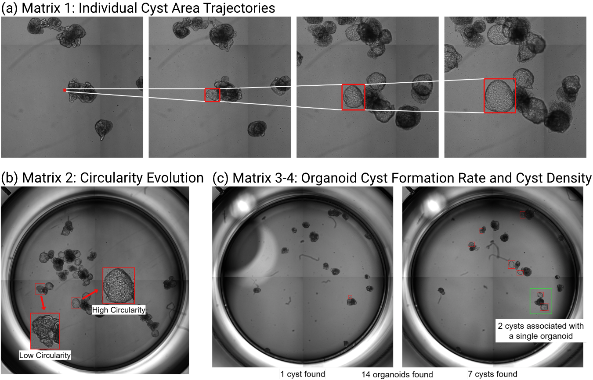

# Outputs and measurements

## Output files

After analysis, the following files are generated in `data/output_videos/`:

- `multi_object_overlay.mp4` - Annotated tracking video
- `multi_object_mask.mp4` - Binary mask visualization
- `multi_object_side_by_side.mp4` - Original and mask comparison
- `raw_cyst_data.csv` - One row per cyst and time point (area, circularity, source frame)
- `cyst_summary.csv` - One row per cyst, with its growth rate
- `organoid_summary.csv` - One row per organoid, with summed cyst areas (see Known limitations below)
- `organoid_analysis_report.pdf` - Publication-ready report
- `analysis_summary.json` - Complete session metadata
- `visualizations/` - Individual plots and figures
- `prompts/<video>_<timestamp>_<run id>.json` - Prompts, organoid associations and provenance of each tracking run
- `runs/<video>_<timestamp>_<run id>/` - The saved result of each tracking run in the window (see [usage.md](usage.md))

## What the reports record

Report columns retain their existing growth-rate values and include `Growth_Rate_Definition` to distinguish
mean adjacent observed cyst slopes from endpoint total-area slopes. The JSON growth summary records its
aggregation definition. Missing masks are not proof of biological absence; PDF measurement warnings and
figure labels state this limitation. Keep `analysis_summary.json` with the CSV files when replotting:
measurement rows alone cannot reconstruct acquisition times or tracking coverage.

`raw_cyst_data.csv` ends with `Source_Frame`: the zero-based frame of the source video behind each row's
`Frame` (the zero-based index among the selected time points). The window and the PDF count frames from 1.
The overlay and side-by-side videos label each mask with `C` and its `Cyst_ID` and show the time point
with its source frame (counted from 1); the mask video carries no text. Days are not written into video
frames: they are analysis inputs that an exported copy may change, and the PDF lists them per source frame. `visualizations/cyst_key.png`, also on the PDF's first pages, is one
labelled overlay of the frame with the most accepted masks. The PDF summary names the source video, the
first characters of its SHA-256, the run, the model, the tracking software and the selected source frames
with their days. These additions change no measurement.

`original` video export preserves the requested source resolution (twice the width for side by side).
`mid` and `low` apply factors of 0.5 and 0.25. Untracked frames are labelled **NOT TRACKED**.
SVG export also writes PNG companions for PDF embedding and desktop preview. Plot DPI and text/title
visibility follow the visualization settings.

## Frame order and timing

Frames are handled in chronological order throughout. With Reverse Tracking enabled, prompts are placed on the last frame and SAM2 propagates backwards in time; outputs are always written chronologically. The tracking progress dialog has a Cancel button: the frame in progress finishes, the tracked frames stay available for videos, the report and Save Results (as a cancelled run), and tracking again on the same video produces the masks of an uninterrupted run. The "Time Lapse (days)" value is the span from the first to the last frame, and days are numbered from 1 as in the paper's figures (seven daily frames spanning six days are days 1 to 7).

## Measurement conventions

Area counts foreground pixels and multiplies by the square of the micrometers-per-pixel calibration.
Circularity uses the largest external contour's polygon area and perimeter, as `4πA/P²`, clipped to
`[0, 1]`; disconnected components and holes therefore affect area and circularity differently.
Formation percentage and cyst density use every annotated organoid as the denominator. These are
per-frame measurements; a missing mask does not establish biological absence.

Cyst growth is the mean of the area-change-per-day slopes between consecutive measured time points.
The organoid summary instead reports the endpoint slope of summed cyst area; the JSON growth statistics
summarize each organoid's mean cyst growth. The heatmap groups cysts at the 33rd and 67th percentiles.
Raw CSV values retain floating-point precision for re-analysis; summary tables round values for display.
Keep the raw CSV, organoid summary and analysis JSON together when re-plotting.

## Known limitations

- **Organoid totals count a missing mask as no area.** `organoid_summary.csv` sums the areas of the
  cysts that have an accepted mask at each time point and reports the endpoint slope of that sum. A cyst
  without a mask at the first or the last time point therefore changes its organoid's totals and growth
  rate, and can change the sign of the rate, although a missing mask does not establish biological
  absence. An organoid with no measured cyst is written with zeros. Compare growth with
  `cyst_summary.csv`, which uses only the time points each cyst was measured at, and read the organoid
  totals together with the accepted-mask counts in the PDF.
- **Circularity depends on size.** The contour estimate stays below 1 for a circle and rises with its
  radius: an ideal disc measures 0.76 at a radius of 5 pixels, 0.88 at 30 and 0.90 at 120. A cyst that
  only grows therefore appears to become rounder, and the reference line at 1.0 in the figures cannot be
  reached. Compare circularity between cysts of similar size; a rising curve alone does not show a
  change of shape.
- **Validated scope.** Bright-field videos only. Accuracy against expert annotations has not been
  measured: the tests establish consistent behavior, not biological accuracy.
- **Platform.** The Docker preview runs on Linux x86-64 and needs a trusted single-user host (its
  desktop has no login). An installation on an independent clean host has not been validated. Windows
  and macOS are not supported by the preview.
